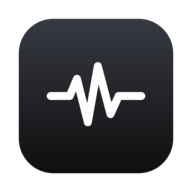
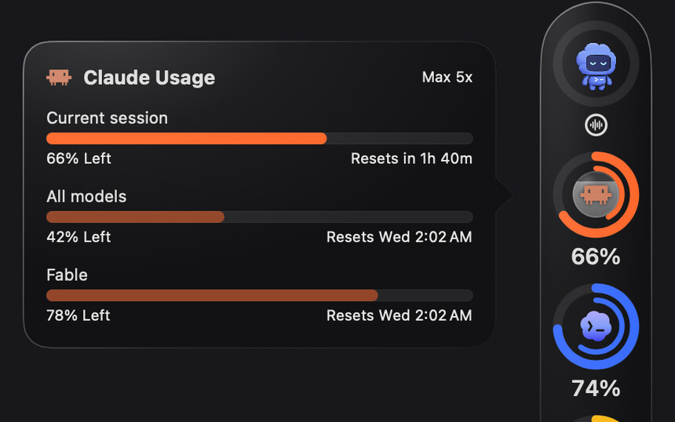
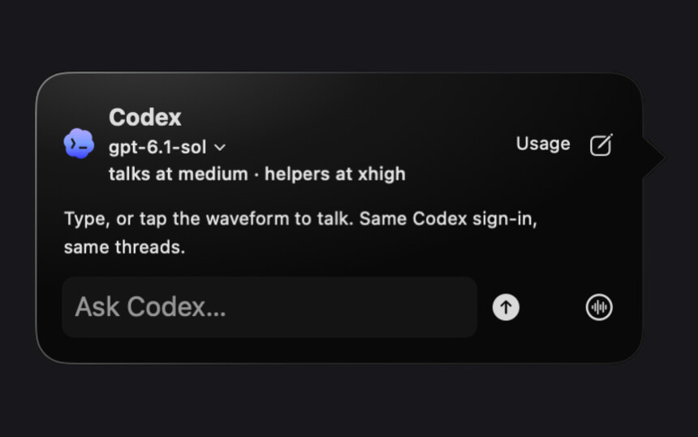
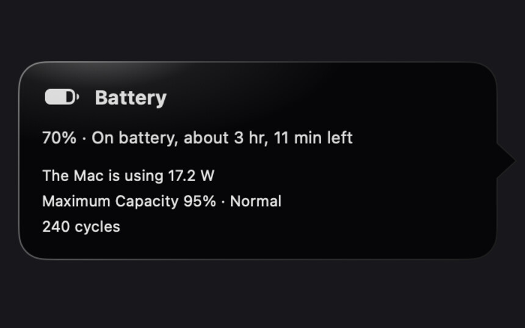
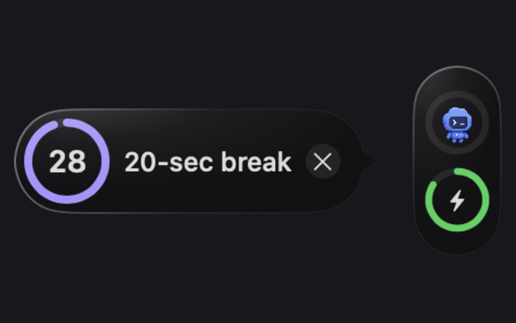
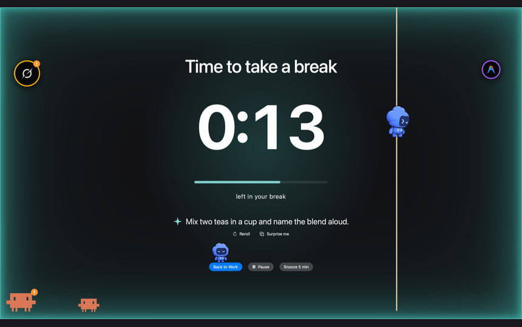
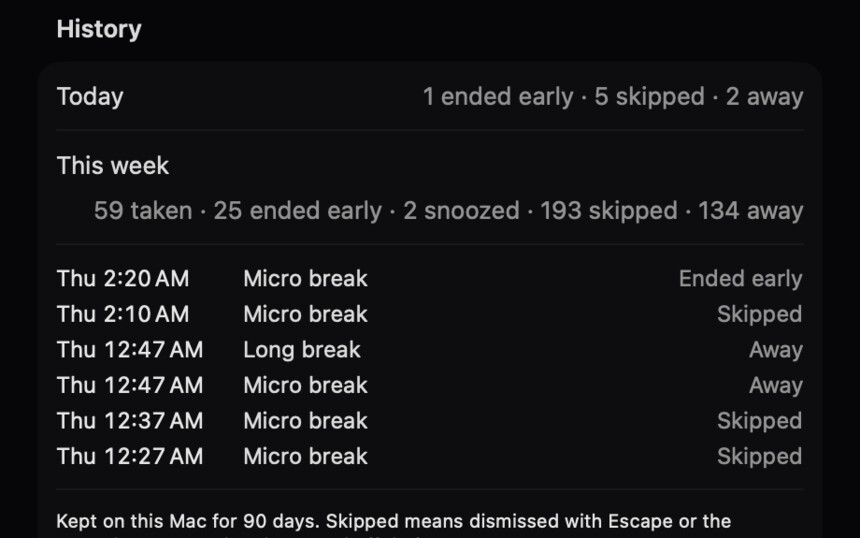

<h1 align="center">
   
  Pulse
</h1>

Floating usage rings for Claude, Codex, Grok and Antigravity, plus a Codex pet, battery status and break reminders.

Provider subscription sign-ins; no Pulse account, AI API keys or backend.

  <a href="https://github.com/tommyent/pulse/releases/latest"><strong>Download</strong></a> ·
  <a href="https://tommyent.github.io/pulse/"><strong>Website</strong></a> ·
  <a href="docs/features.md"><strong>All features</strong></a> ·
  <a href="docs/"><strong>Docs</strong></a>

## Features

Click a picture to see it full size.

<table>
  <tr>
    <td width="33%" valign="top"> <b>Usage rings</b> show limits and reset times</td>
    <td width="33%" valign="top"> <b>Codex pet</b> for text and live voice</td>
    <td width="33%" valign="top"> <b>Battery card</b> and low-charge alerts</td>
  </tr>
  <tr>
    <td valign="top"> <b>Break countdown</b> before each reminder</td>
    <td valign="top"> <b>Break screen</b> with ideas and agents</td>
    <td valign="top"> <b>Break history</b> tracks time away and rests</td>
  </tr>
</table>

[All features →](docs/features.md)

## Install

1. [Download Pulse](https://github.com/tommyent/pulse/releases/latest) and open the DMG.
2. Drag Pulse to Applications and open it.
3. Sign in to the provider CLIs you use, or choose **Connect** for Claude and Grok. [Setup details](docs/getting-started.md).

Tested on macOS 26.5.1 on Apple silicon. Releases are signed, notarized and update in the app.

## Docs

[Features](docs/features.md) · [Codex pet](docs/codex-pet.md) · [Install and setup](docs/getting-started.md) · [Privacy](docs/privacy.md) · [Build and test](docs/development.md) · [Release notes](docs/releases/)

## Credits and licence

Updates use [Sparkle](https://sparkle-project.org). Pulse is [MIT licensed](LICENSE).
