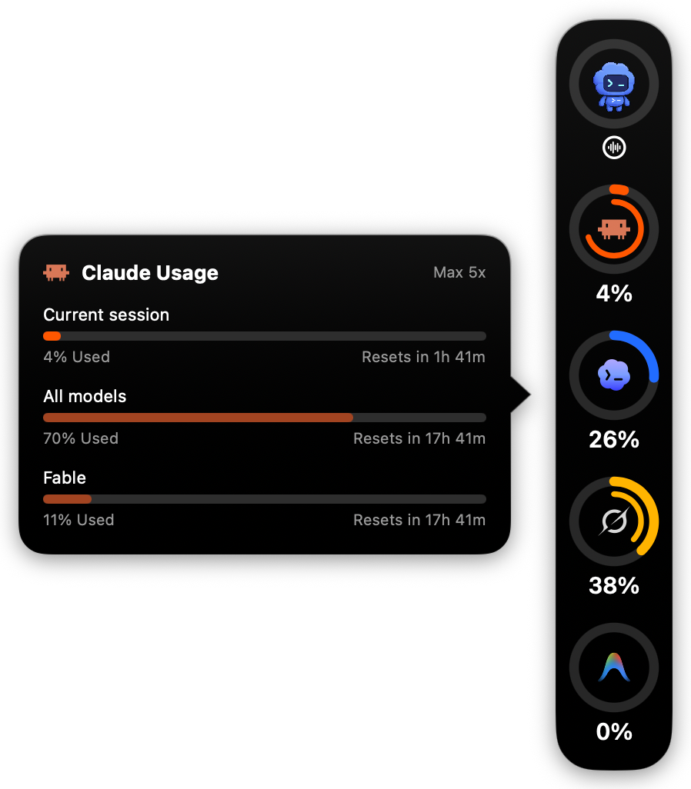
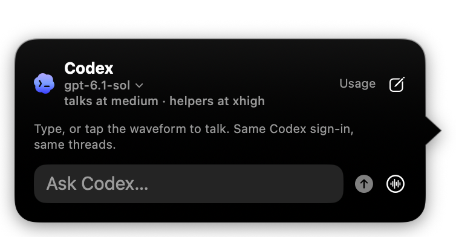
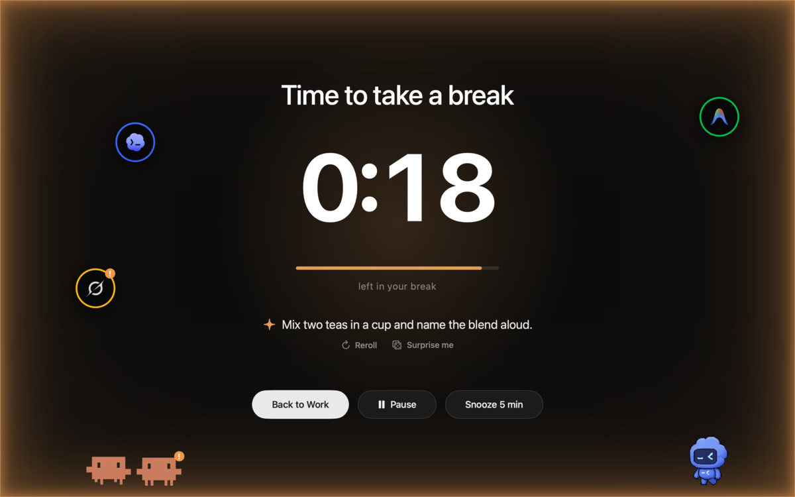
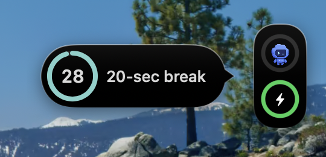
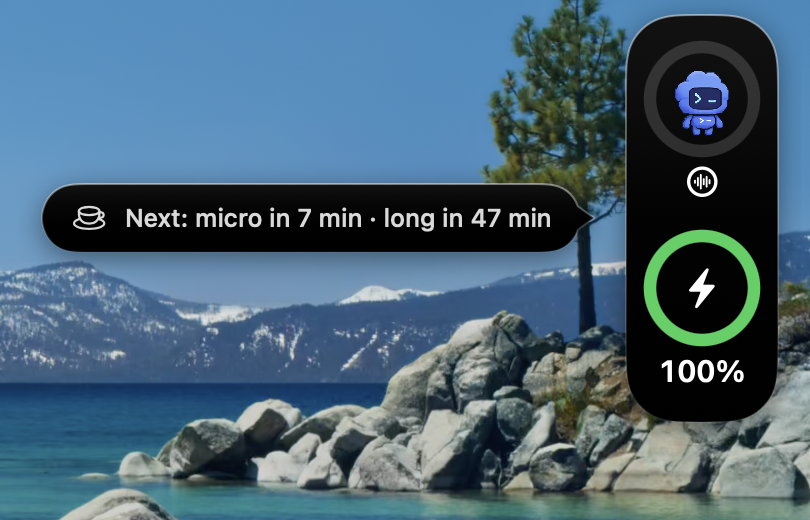
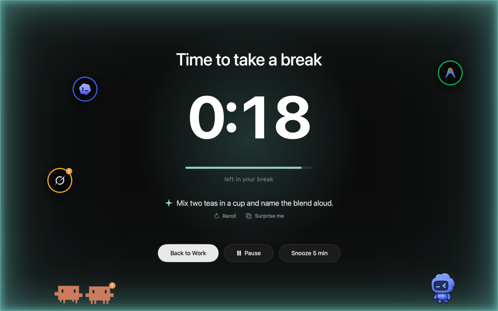
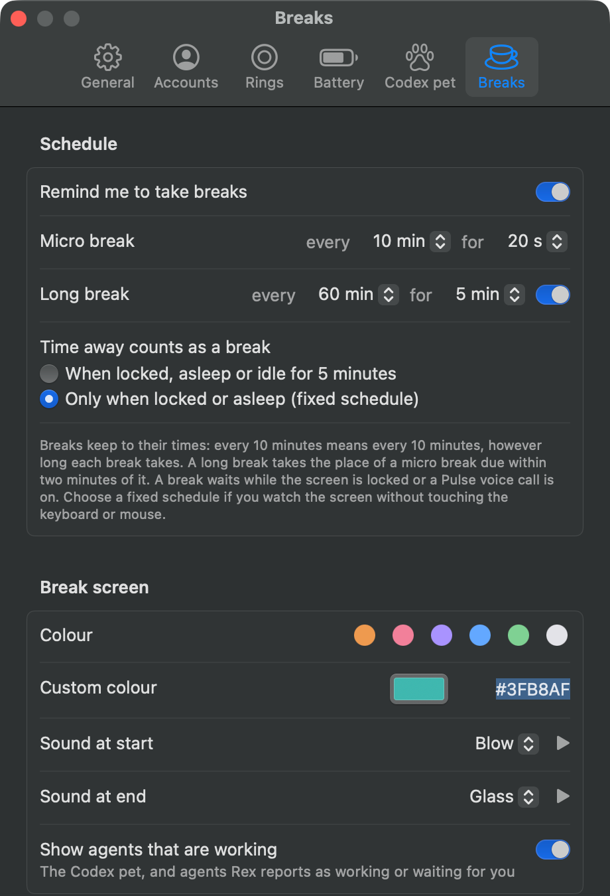
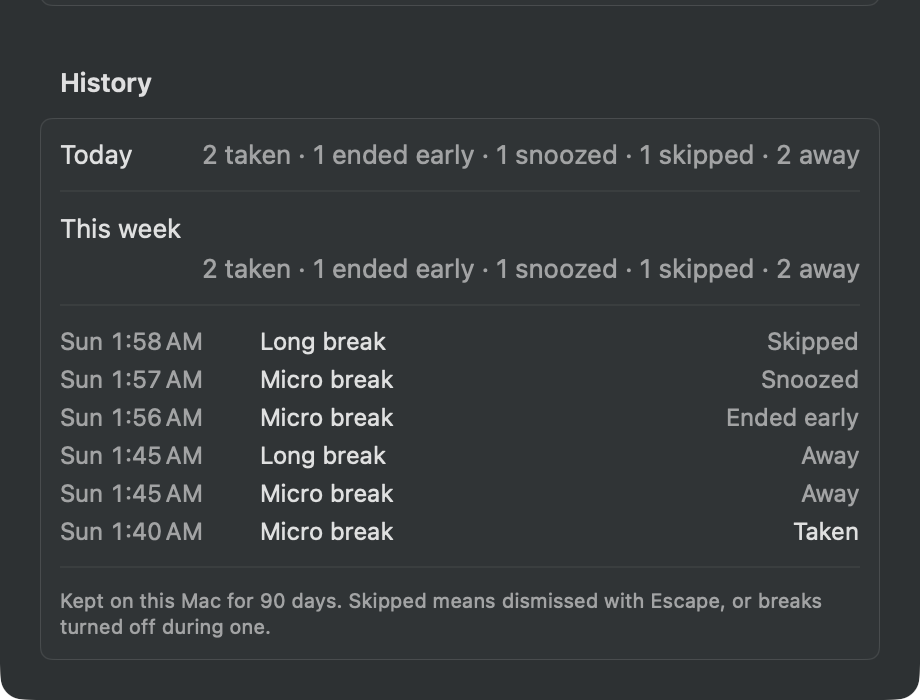

# Pulse

A macOS menu bar app with floating usage rings for Claude, Codex, Grok and Antigravity, plus a Codex pet you can chat with by text or live voice. Usage refreshes every 2 minutes.

Everything runs on your own subscription sign-ins. There are no API keys, no accounts with Pulse, and no backend of its own.

<p align="center">
  
  &nbsp;
  
</p>

## Requirements

- **Run:** macOS 26 or later. Tested on Apple Silicon; Intel is untested.
- **Build:** Xcode 26 or later (the Command Line Tools alone lack the SwiftUI macro plugin) and Swift 6.2 or later. No third-party packages.
- **Codex:** a signed-in Codex CLI (`codex login`). Voice needs a CLI package containing `codex-voice-host` (tested with 0.160.0), microphone permission, and an account that supports the CLI's experimental realtime protocol.
- **Claude and Grok:** sign in through their CLIs, or use **Connect** in Pulse's Settings. Grok CLI support reads Grok Build's `~/.grok/auth.json`.
- **Antigravity:** the Antigravity CLI (`agy`) 1.1.11 or later (tested with 1.2.16), signed in by running `agy` once. The ring shows the Gemini or Claude and GPT pool nearer its limit; the card lists both pools' 5-hour and weekly limits.

Pulse looks for the Codex and `agy` executables in `~/.local/bin`, `/opt/homebrew/bin` and `/usr/local/bin`, and for Codex also in `~/.codex/bin`. If yours lives elsewhere, link it into `~/.local/bin`; apps launched from Finder do not inherit your shell's PATH.

## Build and install

```sh
./package.sh --install     # builds .build/Pulse.app and puts it in /Applications
open /Applications/Pulse.app
```

Without `--install` the bundle stays in `.build`. An existing installed copy is moved to the Trash, never deleted. `./build.sh` makes a development executable instead.

Signing is ad-hoc by default, so no certificate is needed. macOS ties microphone permission to the code signature, and an ad-hoc signature changes on every build, so if you rebuild often set `CODE_SIGN_IDENTITY` to a self-signed identity from Keychain Access. A `.env` file in the project folder is sourced by the scripts and ignored by git, so it is a good place for that.

Releases are source only: download a tagged release or clone the repository, then build as above.

## Use

### Usage rings

Click the menu bar icon for Settings, which has a tab for each part of Pulse: General, Accounts, Rings, Battery, Codex pet and Breaks. **Settings → General → Launch at login** starts Pulse when you log in. Drag the rings to any screen edge; top and bottom lay out horizontally. Pulse always uses a dark appearance, including its Settings and menu bar popover. The rings and cards use system Liquid Glass with a black tint. Turn off **Tint the glass** in Settings to leave the dark system glass untinted. Click a ring for that account's windows and reset times; the card slides along the rail so its tail points at the ring.

Each ring's outer arc is the account's leading window, usually the 5-hour session, and the inner arc the next, usually the weekly limit. A per-model cap, such as Claude's weekly limit for one model or an Antigravity model's own limit, fills the disc behind the logo with the track's gray, rising as it's used. When a window reaches 98%, the ring gets a red badge and Pulse shows an alert in the middle of the screen with the account, the window and when it resets. It comes again at 99% and at 100%, each once per reset period, and stays until you click **Dismiss**, so it can't slip by unseen; while it's open, a newer step just updates its numbers. **Show what's left** in Settings turns the rings, bars and percentages around: they show what's left and empty as you use them, and the disc falls instead of rising.

### Battery

On a Mac with a battery, the last ring on the rail is the battery: at the bottom of a vertical rail, at the right end of a horizontal one. It's green, turns yellow at the low level and red at the critical level, and shows a bolt while the Mac is plugged in.

When the charge reaches either level, Pulse shows its own alert in the middle of the screen with the percentage and, when macOS has an estimate, the time left. It never uses Notification Center. The alert doesn't take the keyboard, ignores clicks for its first second, and stays until you click **Dismiss** or plug in; plugging in also stops its sound. Each level alerts once per discharge.

**Settings → Battery** sets both levels (20% and 10% by default), a sound for each, and whether it loops until you act. The sounds are macOS's alert sounds, anything in `~/Library/Sounds`, and audio files you add with **Import Sounds…**, which copies them into `~/Library/Application Support/Pulse/Sounds`. If `~/.config/pushover.env` holds `PUSHOVER_USER` and `PUSHOVER_TOKEN` (and optionally `PUSHOVER_DEVICE`) for [Pushover](https://pushover.net), a critical alert is also pushed to your phone; **Send Test Push** checks the setup.

To try the alerts without draining the battery, simulate a charge: `defaults write app.pulse simulatedBattery "8 25"` is 8% with 25 minutes left, `"8 ac"` is plugged in, and `defaults delete app.pulse simulatedBattery` returns to the real battery.

### Breaks

Turn on **Settings → Breaks → Remind me to take breaks** for regular breaks from the screen: by default a 20-second micro break every 20 minutes and a 5-minute long break every hour, which takes the place of a micro break due within two minutes of it. Both are set there, and the long break can be turned off. Breaks keep to their times: each is due one interval after the previous one was due, however long that one took, so every 20 minutes means every 20 minutes. With the pointer over the rail, and in the menu bar menu, Pulse shows when the next ones come.

<p align="center">
  
</p>
<p align="center">
  
  &nbsp;
  
</p>

Thirty seconds before a break, a small countdown grows out of the middle of the rail: the seconds left in a ring that empties, and the break's length. Click it to start the break now; otherwise the break starts when the ring is empty. With the rings hidden, the countdown appears at the middle of the screen's right edge.

The break covers every display: a dark screen with a coloured glow at its edges, the time left, and **Back to Work** (ends it early), **Pause** and **Snooze 5 min** (brings the same break back in 5 minutes without moving the ones after it). Escape skips it. The colour is violet by default, one of six presets, or your own: the colour well opens the Mac's colour picker, whose sliders also take a hex code. A sound plays as a break starts and another when it has run its full length (Blow and Glass by default, at the system volume), so you can rest your eyes and still know when it's over; choose others, your own imported sounds or None in Settings → Breaks. Snooze, Escape and Back to Work end a break without a sound.

- **Waiting:** no break starts during a Pulse voice call, while another app is using the microphone, as on a video call (**Wait during calls**, on by default), or while the screen is locked; it comes once that's over. A countdown already showing stops for any of these, a break on screen only for the lock. Time on a call doesn't count as time away.
- **Pause:** for a meeting that isn't a call on this Mac, hover over the rail and choose **Pause** for 30 minutes, 1 hour or 2 hours. The hint then says when breaks come back and offers **Resume**. A pause outlasts a restart, and a break that came due during it comes as it ends.
- **Time away counts as a break**, and the clocks start over when you come back. By default that's the screen locked or the Mac asleep for as long as a break, or 5 minutes with no keyboard or pointer input. Choose **Only when locked or asleep (fixed schedule)** if you watch the screen without touching anything: then no input never counts.
- **Restarts:** the times are saved, so after quitting, an update or a restart Pulse carries on where it was, with at most one overdue break at launch. Time it wasn't running counts as time away by the same rules; with the fixed schedule only the time the Mac was off counts.
- **History:** **Settings → Breaks → History** counts today's and this week's breaks by how they ended (taken, ended early, snoozed, skipped, or time away) and lists the latest. It's kept on this Mac for 90 days.
- **Ideas:** under the timer, Pulse suggests something quick to do, picked from its list of over 300 ideas at the level you set in Settings: Easy, Middle or Wild. Add your own in **Your own ideas**, one per line; they come up about one break in three. **Reroll** picks another at your level, and **Surprise me** picks from any level. Ideas you've seen lately wait until the rest have come up.
- **Agents:** with **Show agents** on, the Codex pet walks out along the bottom of the break screen. If you use [Rex](https://www.superlogical.com/rex), the agents it reports join it, from this Mac and from the other Macs Rex connects to: Claude Code agents as crabs and Codex agents as small Codex pets, in mixed sizes along the bottom, while Antigravity and Grok agents float around the edges. Working ones stroll and do tricks: they jump, flip, bounce, climb ladders onto the buttons, fly up to the top of the screen, and come back down on a rope or spinning under a propeller cap. An agent waiting for you stands still with a "!". Idle ones sit dimmed and snore, and get up as the break ends. Hover over one for its pane and status. With Reduce Motion on, they stand still.
- **Party mode** dresses them up: a nightcap to sleep in, a hard hat to work in, a party hat for an agent that finished in the last 15 minutes, and now and then a costume or a prop, more often in a crowd. With **Holiday surprises** on there are holiday hats too: witch hats and ghosts the week of Halloween, pilgrim hats Thanksgiving week and Santa hats in December, and a short film plays behind the countdown on Halloween and Thanksgiving. Turn Party mode off for plain agents.

<p align="center">
  
</p>
<p align="center">
  
  &nbsp;
  
</p>

To try it without waiting, turn breaks on and run `defaults write app.pulse simulatedBreak micro` (or `long`): each run is one countdown, and a simulated break leaves the schedule alone. `defaults write app.pulse simulatedAgents "claude-code working, codex blocked"` shows stand-in agents instead of Rex's, and `defaults write app.pulse simulatedIdea "…"` shows that text as every break's idea; `defaults delete app.pulse simulatedAgents` (or `simulatedIdea`) undoes either. Pulse logs what breaks do, from each countdown to how it ended and what counted as time away: `log stream --predicate 'subsystem == "app.pulse" AND category == "breaks"'`.

### The Codex pet

Click the pet to chat. **Settings → Codex pet → Show the Codex pet** hides it, separately from the Codex usage ring. Hiding it, or the usage rings on the desktop, ends a call, frees the voice shortcut and starts nothing new; work already running finishes, then Pulse stops Codex until you open the pet again.

- **Voice:** the waveform button below the expanded pet ring starts or ends voice without opening the pop-out. **Command-click the pet** to start voice, then Command-click again to end the session; another Command-click starts a new voice session. Command-click leaves the pop-out closed (or preserves the current card).
- **Status:** the **ring around the pet** is gray when voice is off, yellow only while connecting, Codex blue while listening, and red when the microphone is paused. A white slashed-microphone badge and **Microphone paused · voice still on** in the card also show the paused state; replies can still play. The waveform buttons use the same colors, and Pulse plays the macOS Pluck sound when the microphone goes live and Pong when a live call ends.
- **Shortcut:** **⌃⌥Space** opens the pet and starts hands-free voice. Tap it to pause the microphone, and tap again to resume. Hold it to talk: when you let go, only the microphone pauses and the call stays open, so Codex can still answer aloud. The first press opens the call, so start speaking after the start sound; later presses reuse the open call. If an audio device changes while you're holding it, the call reconnects paused, so press again. The shortcut is configurable in Settings, and one you set before is kept.
- **Ending a call:** double-tap the shortcut, press Escape (which also closes the card), click the waveform button, or Command-click the pet. Closing the card by clicking elsewhere does not end a call. A paused microphone sends only silence, but the call stays connected, so end the call when you're done talking.
- **Coming back:** when work finished while no call was on, Pulse gives the next call those results and asks the voice to open with a one-sentence summary; the full results are in the chat.

Audio capture and playback use the native voice helper from your installed Codex package. Pulse includes the Codex thread's startup context in voice sessions. The audio helper does not change the thread's file or tool permissions.

### Permissions

The pet starts in `~/Documents/codex-pet` and may read other folders, such as `~/Projects` or `~/Downloads`, without asking. Before it writes to or acts in another folder, it requests access, and Codex's [auto-review](https://learn.chatgpt.com/docs/agent-approvals-security) decides, whatever `approvals_reviewer` your own Codex configuration sets: a Codex reviewer approves or denies each request by its risk. Pulse doesn't show those decisions. A request Codex still sends to you appears in Pulse's permission dialog, which shows the command, file changes, or requested paths. **Allow once** approves one action; **Allow for this task** grants the requested access until the current Codex turn ends. **Always allow** remembers matching requests across restarts: the exact command and working folder, the same requested access, or the same file paths and operation types. A command whose working folder Codex doesn't give can only be allowed once. A broader or different request still asks. **Deny** grants nothing. When a tool such as browser or app control asks for consent and Codex can remember the answer, **Allow for this conversation** lets that tool run again in this conversation without asking; Codex keeps that choice for that tool until the conversation is reopened, for example after a Pulse restart. Use **Settings → Codex pet → Reset remembered approvals** to ask again for future requests; existing task grants expire when the task ends.

Codex tools can also ask for consent, such as Browser Use asking to open a website. **Allow** and **Deny** are remembered by that tool, not by Pulse: Browser Use keeps site decisions for the rest of the conversation, so start a **New conversation** to be asked again. **Not now** (Esc) decides nothing. Multiple-choice questions from Codex appear as a dialog. Requests Pulse can't show faithfully, such as sign-ins, links, verification codes, secrets or free-text questions, are cancelled or left unanswered, never answered for you, and a note in the chat says what happened. During a call, a prompt also plays a sound and the voice tells you it's waiting; you answer in the window, never by voice.

### Conversations and helpers

The pet keeps one conversation across restarts. Opening it shows the recent messages, and **Load earlier messages** goes further back. It shows typed messages, requests Codex acted on and its replies; the rest of a voice call isn't shown. Each result of a voice request appears once, without its progress notes, marked **Work result**, or **After the call** if it finished after you hung up. During a call, Pulse forwards completed work results to the voice, as Codex's own CLI does, and only for your latest request in that call; questions and long answers get a pointer to the pet chat instead. **New conversation** starts over and stops any helpers still running. The card's header shows the model Codex works with, its reasoning effort, the folder and when the conversation began; before a conversation opens, it shows what the next one will use. Click it to choose another work model or effort for this conversation and new ones; the voice is a separate realtime model and doesn't change. After an update from a version that didn't keep conversations, the pet reopens its most recent one once; sites a tool blocked in that conversation stay blocked there. Pulse runs its own Codex app-server, so don't continue the pet's conversation in another Codex app at the same time.

For bigger requests, such as building something, research or multi-step changes, the pet can hand the work to a Codex helper (one of Codex's own sub-agents) and tell you it has started, so you can keep talking while the helper works. A card line shows while a helper is working. When it finishes, Pulse asks the pet for a short report: it appears in the chat as **Helper result**, and during the call that asked for the work the voice tells you once. A report waits while you're asking something else. If you ask something new before an answer was spoken, the pet catches you up once the call is quiet, marked **Catch-up** in the chat. The card's Stop button stops the pet's work and its helpers. Ending a call, pausing the microphone or closing the card leaves helpers working, and their results stay in the chat. A helper can use approvals you've already remembered but can't create new ones. With a model that has helpers, when you pick an effort above medium in the card's header, the pet talks at medium so it answers quickly and helpers work at your pick; a new helper effort applies from the next conversation or Pulse restart, as does switching to a model that can't run the helpers' current effort (the header shows what's pending). Helpers need a model whose sub-agent tool supports them; Pulse gives the pet this instruction only in its own conversations, never in the folder's `AGENTS.md`. To keep each request smaller, Pulse's conversations leave out Codex's skills list (a skill still works when you ask for it) and tools the pet doesn't use, such as goals and image generation; web search, your hooks and the approval rules stay.

## Privacy

- Pulse reads the current user's own CLI credentials: Claude Code's Keychain item (through Apple's `security` tool, so it never prompts) or `~/.claude/.credentials.json`, `~/.codex/auth.json`, and `~/.grok/auth.json`. Grok's file is refreshed in place with an atomic, owner-only write.
- Web sign-ins made through **Connect** live in macOS WebKit storage; Grok's saved cookie header uses the Keychain service `app.pulse.auth`. Preferences and usage snapshots live in `~/Library/Application Support/Pulse`. Voice failures log a fixed reason and the helper version; raw helper errors use a private, unlinked temporary file that disappears when the call closes.
- Antigravity usage comes from the CLI's own report: Pulse runs `agy -p /usage --output-format json` in a private temporary folder on each refresh and never reads the Google sign-in. The report is a local command, so it sends no prompt and uses no quota; agy writes its usual log file for each run. Before each run Pulse sends one empty HEAD request to `oauth2.googleapis.com` and skips agy when it gets no answer, because agy opens a browser sign-in when its token refresh hits a network error. If agy reports a sign-out or stalls, Pulse stops running it until you click **Refresh**.
- **Wait during calls** asks macOS's audio system whether any app is recording from a microphone, which needs no microphone permission; Pulse doesn't open the microphone for it or record anything.
- Battery alerts read the battery through macOS's power-source API, which needs no permission. Pulse reads `~/.config/pushover.env` only to check it and to send a push, sends the keys only to `api.pushover.net`, and never saves or logs them.
- Break ideas come from a list built into Pulse; your own ideas stay in Pulse's settings on this Mac. The break times and history stay in `~/Library/Application Support/Pulse` (`break-clock.json`, `break-history.jsonl`, 90 days). Pulse reads Rex only while a break is on screen, through the `rex` command with `--autostart=false`, so it never starts a Rex server; it reads each pane's label and status line and keeps nothing.
- Usage requests go straight to each provider over HTTPS. Authenticated responses are not cached to disk and redirects are refused, so a token is never forwarded off-host.
- Pet chat and audio go through Codex and OpenAI under your Codex account, which may retain threads. The pet thread starts in `~/Documents/codex-pet` with workspace-write sandboxing and on-request approvals decided by Codex's auto-review. Pulse creates the folder and seeds an `AGENTS.md` there when it launches; existing files have only Pulse's original sentences updated, preserving your own instructions. The instructions let the pet read other folders without asking but require permission before it writes to or acts in them, and let it send, pay, book or contact someone only when you explicitly ask for that specific action; an approved permission request doesn't count as asking. The sandbox enforces write restrictions, while normal read access follows Codex's workspace-write policy. Supported approval, consent and question requests that Codex sends to you from the pet and its delegated agents are shown for review. Requests Pulse can't show are cancelled or left unanswered with a note in the chat, so they are never recorded as your refusal; other unknown requests are rejected. Your own Codex configuration and tools apply.

## Checks

```sh
./scripts/check.sh
```

Offline, no sign-ins or audio capture; needs Node.js 18 or later. Covers overlay geometry, reset labels, battery levels, alerts and the Pushover request, the pet sprite sheet, credential writes, redirect and cache policy, the voice shortcut, Grok parsing, the Antigravity report and its version guard, Codex startup, timeouts and broken pipes, the native voice protocol and lifecycle, voice sounds, a denied microphone, Codex Stop, refused messages, the pet's consent and questions, conversation recovery and the work-model choice, the break schedule (due-based spacing, the countdown, pause, snooze, voice calls, locks and both time-away modes), restoring it after a restart, the break history, picking ideas, Rex's status and events, and that settings saved by an older Pulse load unchanged.

Live checks that use your accounts: `./scripts/grok-check.sh` may refresh Grok credentials, and `./scripts/codex-chat-check.sh` opens a temporary conversation with the app's settings, sends one prompt and negotiates a voice session. Provider endpoints and the experimental realtime protocol can change without notice.

`./scripts/approval-ui-check.sh` checks the native permission prompts in a logged-in session. It briefly opens example prompts that close themselves and takes focus while it runs; it starts no Codex process and uses no network, microphone, browser or settings. It isn't part of `check.sh`.

## Layout of the code

| File | Owns |
|---|---|
| `Adapters.swift` | usage fetch for Claude, Codex, Grok and Antigravity; credential reads and Grok token refresh |
| `CodexChat.swift` | Codex app-server client and pet session |
| `VoiceBridge.swift` | installed Codex native voice helper, audio controls and lifecycle |
| `PetApprovals.swift` | native approval, consent and question prompts, scoped replies and cancellation |
| `HotKey.swift` | global shortcut registration and the Settings recorder |
| `Views.swift` | rail, rings, usage cards, pet card, Settings |
| `Breaks.swift` | break settings, schedule, colours and picking ideas |
| `BreakController.swift` | the break clock, idle and lock detection, the overlay windows |
| `BreakViews.swift` | the countdown, the break screen, its agents and Settings → Breaks |
| `BreakIdeas.swift` | loads the idea list, `Resources/break-ideas.json` |
| `RexAgents.swift` | which agents Rex reports as working |
| `PulseApp.swift` | app entry, overlay panel, shortcut binding |
| `AppState.swift` | persisted settings, refresh loop, snapshots |
| `Models.swift` | account IDs, usage windows, snapshots and their health |
| `GrokLogin.swift` | Keychain storage, the embedded sign-in window and the hidden claude.ai session |
| `CodexPetSprite.swift` | the pet's sprite sheet |
| `DockGeometry.swift` | screen-edge docking and outside-click geometry |

## License

MIT. See `LICENSE`.
