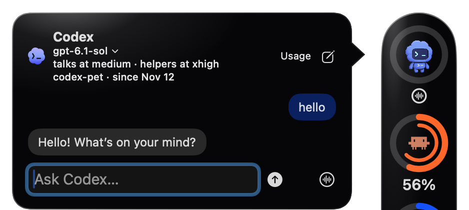

# Codex pet

  

Click the pet to chat. **Settings → Codex pet → Show the Codex pet** hides it, separately from the Codex usage ring. Hiding it, or the usage rings on the desktop, ends a call, frees the voice shortcut and starts nothing new; work already running finishes, then Pulse stops Codex until you open the pet again. With the pet showing, Pulse also stops Codex and its MCP servers once the card has been closed with nothing running for five minutes; opening the card starts it again in the same conversation.

- **Voice:** the waveform button below the expanded pet ring starts or ends voice without opening the pop-out. **Command-click the pet** to start voice, then Command-click again to end the session; another Command-click starts a new voice session. Command-click leaves the pop-out closed (or preserves the current card).
- **Status:** the **ring around the pet** is gray when voice is off, yellow only while connecting, Codex blue while listening, and red when the microphone is paused. A white slashed-microphone badge and **Microphone paused · voice still on** in the card also show the paused state; replies can still play. The waveform buttons use the same colors, and Pulse plays the macOS Pluck sound when the microphone goes live and Pong when a live call ends.
- **Shortcut:** **⌃⌥Space** opens the pet and starts hands-free voice. Tap it to pause the microphone, and tap again to resume. Hold it to talk: when you let go, only the microphone pauses and the call stays open, so Codex can still answer aloud. The first press opens the call, so start speaking after the start sound; later presses reuse the open call. If an audio device changes while you're holding it, the call reconnects paused, so press again. The shortcut is configurable in Settings, and one you set before is kept.
- **Ending a call:** double-tap the shortcut, press Escape (which also closes the card), click the waveform button, or Command-click the pet. Closing the card by clicking elsewhere does not end a call. A paused microphone sends only silence, but the call stays connected, so end the call when you're done talking.
- **Coming back:** when work finished while no call was on, Pulse gives the next call those results and asks the voice to open with a one-sentence summary; the full results are in the chat.

Audio capture and playback use the native voice helper from your installed Codex package. Pulse includes the Codex thread's startup context in voice sessions. The audio helper does not change the thread's file or tool permissions.

## Permissions

The pet starts in `~/Documents/codex-pet` and may read other folders, such as `~/Projects` or `~/Downloads`, without asking. Before it writes to or acts in another folder, it requests access, and Codex's [auto-review](https://learn.chatgpt.com/docs/agent-approvals-security) decides, whatever `approvals_reviewer` your own Codex configuration sets: a Codex reviewer approves or denies each request by its risk. Pulse doesn't show those decisions. A request Codex still sends to you appears in Pulse's permission dialog, which shows the command, file changes, or requested paths. **Allow once** approves one action; **Allow for this task** grants the requested access until the current Codex turn ends. **Always allow** remembers matching requests across restarts: the exact command and working folder, the same requested access, or the same file paths and operation types. A command whose working folder Codex doesn't give can only be allowed once. A broader or different request still asks. **Deny** grants nothing. When a tool such as browser or app control asks for consent and Codex can remember the answer, **Allow for this conversation** lets that tool run again in this conversation without asking; Codex keeps that choice for that tool until the conversation is reopened, for example after a Pulse restart. Use **Settings → Codex pet → Reset remembered approvals** to ask again for future requests; existing task grants expire when the task ends.

Codex tools can also ask for consent, such as Browser Use asking to open a website. **Allow** and **Deny** are remembered by that tool, not by Pulse: Browser Use keeps site decisions for the rest of the conversation, so start a **New conversation** to be asked again. **Not now** (Esc) decides nothing. Multiple-choice questions from Codex appear as a dialog. Requests Pulse can't show faithfully, such as sign-ins, links, verification codes, secrets or free-text questions, are cancelled or left unanswered, never answered for you, and a note in the chat says what happened. During a call, a prompt also plays a sound and the voice tells you it's waiting; you answer in the window, never by voice.

## Conversations and helpers

The pet keeps one conversation across restarts. Opening it shows the recent messages, and **Load earlier messages** goes further back. It shows typed messages, requests Codex acted on and its replies; the rest of a voice call isn't shown. Each result of a voice request appears once, without its progress notes, marked **Work result**, or **After the call** if it finished after you hung up. During a call, Pulse forwards completed work results to the voice, as Codex's own CLI does, and only for your latest request in that call; questions and long answers get a pointer to the pet chat instead. **New conversation** starts over and stops any helpers still running. The card's header shows the model Codex works with, its reasoning effort, the folder and when the conversation began; before a conversation opens, it shows what the next one will use. Click it to choose another work model or effort for this conversation and new ones; the voice is a separate realtime model and doesn't change. After an update from a version that didn't keep conversations, the pet reopens its most recent one once; sites a tool blocked in that conversation stay blocked there. Pulse runs its own Codex app-server, so don't continue the pet's conversation in another Codex app at the same time.

For bigger requests, such as building something, research or multi-step changes, the pet can hand the work to a Codex helper (one of Codex's own sub-agents) and tell you it has started, so you can keep talking while the helper works. A card line shows while a helper is working. When it finishes, Pulse asks the pet for a short report: it appears in the chat as **Helper result**, and during the call that asked for the work the voice tells you once. A report waits while you're asking something else. If you ask something new before an answer was spoken, the pet catches you up once the call is quiet, marked **Catch-up** in the chat. The card's Stop button stops the pet's work and its helpers. Ending a call, pausing the microphone or closing the card leaves helpers working, and their results stay in the chat. A helper can use approvals you've already remembered but can't create new ones. With a model that has helpers, when you pick an effort above medium in the card's header, the pet talks at medium so it answers quickly and helpers work at your pick; a new helper effort applies from the next conversation or Pulse restart, as does switching to a model that can't run the helpers' current effort (the header shows what's pending). Helpers need a model whose sub-agent tool supports them; Pulse gives the pet this instruction only in its own conversations, never in the folder's `AGENTS.md`. To keep each request smaller, Pulse's conversations leave out Codex's skills list (a skill still works when you ask for it) and tools the pet doesn't use, such as goals and image generation; web search, your hooks and the approval rules stay.
