# Features

## Usage rings

Usage refreshes every 2 minutes.

  <a href="screenshots/usage-card.png">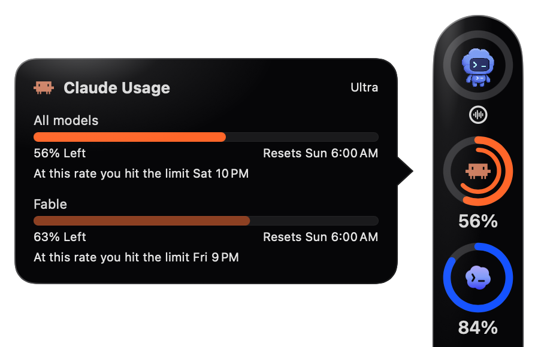</a>

  <a href="screenshots/rail-collapsed.png">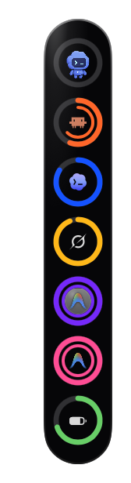</a>
  &nbsp;
  <a href="screenshots/rail-expanded.png">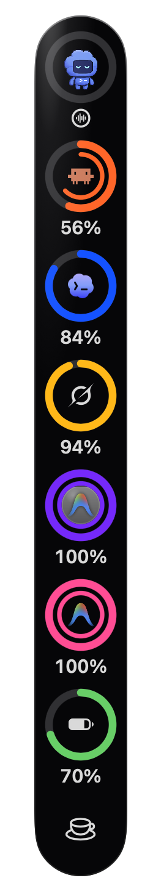</a>

Click the menu bar icon for Settings, which has a tab for each part of Pulse: General, Accounts, Rings, Battery, Codex pet and Breaks. **Settings → General → Launch at login** starts Pulse when you log in. Pulse always uses a dark appearance, including its Settings and menu bar popover. **Settings → General → Appearance** chooses **Glass**, untinted dark Liquid Glass, or **Solid**, an opaque dark surface. Both are lit softly from the top left, except on the break screen and in Settings. The chosen look applies to the rail, cards, countdown, alerts, menu and Settings. Click a ring for that account's windows and reset times; the card slides along the rail so its tail points at the ring.

The rings sit in a rail at a screen edge, small and without numbers until the pointer is over them; then they grow and show their percentages. Drag the rail to any edge and let go, or flick it toward one: it glides there. At the top and bottom the rings line up in a row, each with its percentage beside it, so the open rail only grows in length; at the sides each percentage sits under its ring. When the rail is in the way, push it into its own edge until the pointer stops at the edge of the screen, or goes into the menu bar or the Dock, and let go (a fast flick into that edge works too). It tucks away, leaving a thin sliver with a coloured tick for each ring, longer the fuller the ring. A limit near its end adds a red dot to the tick, and the tick turns red when that limit is the account's longest, usually its week. Click the sliver to bring the rail back to the same spot, or drag it out to any edge. **Minimize the rings to their edge** in the menu bar popover does the same, and a tucked rail stays tucked after a restart. **Settings → Rings → Peek when the pointer rests on the minimized rings**, off by default, slides the rail out while the pointer rests on the sliver. With Reduce Motion on, the rail moves without gliding.

Each ring's outer arc is the account's shortest limit, usually the 5-hour session, and the inner arc the next, usually the weekly limit. A per-model cap, such as Claude's weekly limit for one model or an Antigravity model's own limit, fills the gray disc behind the logo, rising as it's used. With only one general limit, the cap takes the inner arc instead and the disc is left for a second cap. When there are more caps than places, the ring shows the fullest. Models that share limits of their own get a ring of their own: Antigravity's Gemini pool is violet, and its Claude and GPT pool is sky blue, with a switch in **Settings → Accounts** to hide it. Grok has one limit, its credits, so its ring has one arc and the card lists what each product used. When a window reaches 98%, the ring gets a red badge and Pulse shows an alert in the middle of the screen with the account, the window and when it resets. It comes again at 99% and at 100%, each once per reset period, and stays until you click **Dismiss**, so it can't slip by unseen; while it's open, a newer step just updates its numbers. **Show what's left** in Settings turns the rings, bars and percentages around: they show what's left and empty as you use them, and the disc falls instead of rising. Grok's products are shares of its credits rather than limits of their own, so the card always shows what they used.

<a href="screenshots/antigravity-rings.png">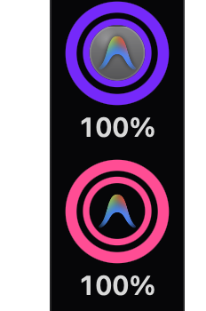</a>

When the recent pace would use up a limit before it resets, its row on the card and in the menu bar popover adds a line such as "At this rate you hit the limit Sat 3 PM", and VoiceOver reads it. That's what the current rate works out to, not a prediction, so it goes away when use slows, and its time is rounded down. The pace is the rise in the used percent over the last 24 hours, or since Pulse first saw this limit period if that's more recent. The line waits for 10% used and 20 minutes of readings, and shows only from a live reading under 10 minutes old. Pulse starts the pace over when the reset time moves by 15 minutes or more, when the used percent falls by more than 5 points, and after a day without a reading. Rings, badges and alerts don't use it.

When a refresh fails, the ring dims and keeps its last numbers, and its card says when they're from and why. By the next refresh after a window's reset time, its old number is gone: the ring shows a dash and the card says "Reset since the last update", until a refresh succeeds. A window with no reset time keeps its last number. A provider that doesn't answer within 2 minutes counts as a failed refresh, so it can't hold up the others.

<a href="screenshots/all-accounts.png">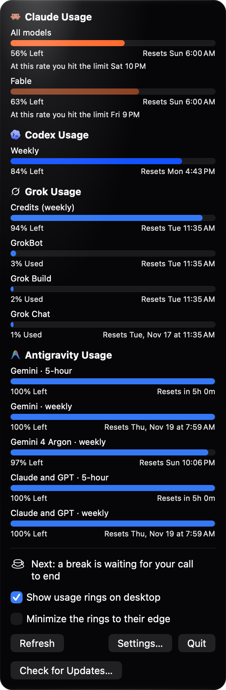</a>

## Battery

On a Mac with a battery, the last ring on the rail is the battery: at the bottom of a vertical rail, at the right end of a horizontal one. It's green, turns yellow at the low level and red at the critical level, and shows a bolt while the Mac is plugged in.

Click it for its card: the charge and whether it's charging, with the time until full or the time left; what the whole Mac is drawing, how much of it goes into the battery and the adapter's wattage; the battery's Maximum Capacity and condition as System Settings shows them; its cycle count; and whether Low Power Mode is on. It reads the numbers when it opens and the power every few seconds while it stays open.

  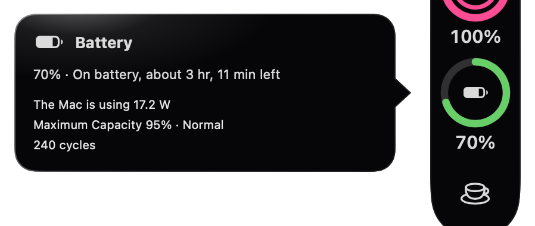

When the charge reaches either level, Pulse shows its own alert in the middle of the screen with the percentage and, when macOS has an estimate, the time left. It never uses Notification Center. The alert doesn't take the keyboard, ignores clicks for its first second, and stays until you click **Dismiss** or plug in; plugging in also stops its sound. Each level alerts once per discharge.

**Settings → Battery** sets both levels (20% and 10% by default), a sound for each, and whether it loops until you act. The sounds are macOS's alert sounds, anything in `~/Library/Sounds`, and audio files you add with **Import Sounds…**, which copies them into `~/Library/Application Support/Pulse/Sounds`. If `~/.config/pushover.env` holds `PUSHOVER_USER` and `PUSHOVER_TOKEN` (and optionally `PUSHOVER_DEVICE`) for [Pushover](https://pushover.net), a critical alert is also pushed to your phone; **Send Test Push** checks the setup.

To try the alerts without draining the battery, simulate a charge: `defaults write io.github.tommyent.pulse simulatedBattery "8 25"` is 8% with 25 minutes left, `"8 ac"` is plugged in, and `defaults delete io.github.tommyent.pulse simulatedBattery` returns to the real battery.

## Breaks

Turn on **Settings → Breaks → Remind me to take breaks** for regular breaks from the screen: by default a 20-second micro break every 20 minutes and a 5-minute long break every hour, which takes the place of a micro break due within two minutes of it. Both are set there, and the long break can be turned off. Breaks keep to their times: each is due one interval after the previous one was due, however long that one took, so every 20 minutes means every 20 minutes. The menu bar menu shows when the next ones come.

**Settings → Breaks → Show agents** puts the Codex pet on the break screen. Claude Code, Codex, Antigravity and Grok agents need [Rex](https://www.superlogical.com/rex), Superlogical's terminal in beta for Mac. Without Rex running, only the Codex pet walks out.

  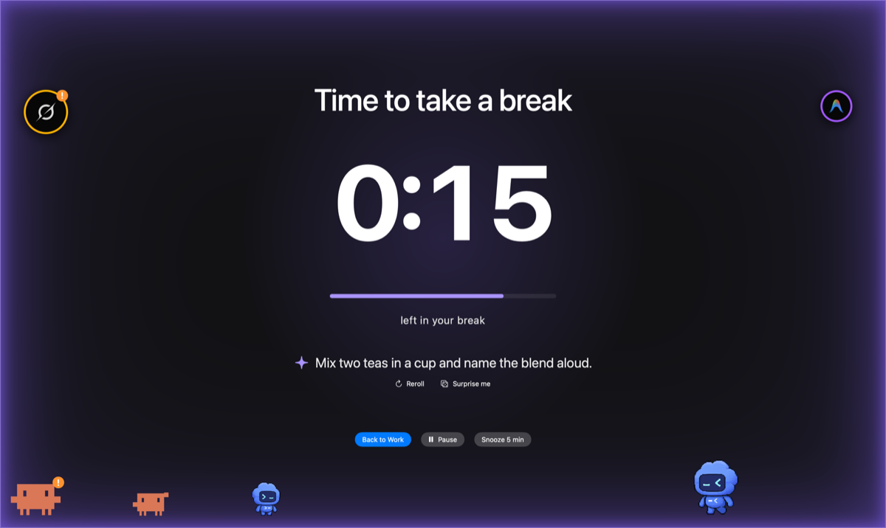

  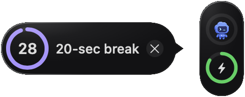
  &nbsp;
  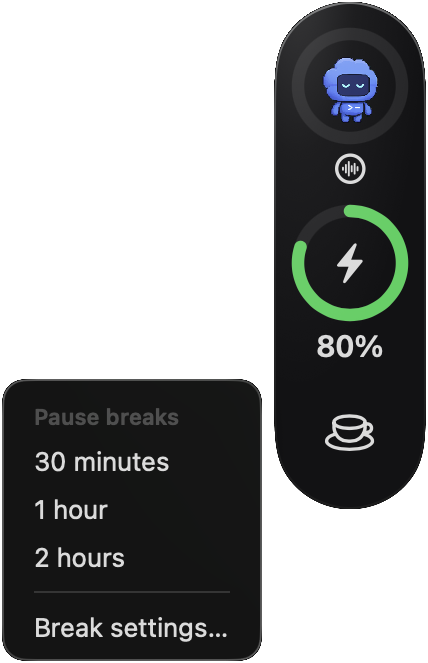

Thirty seconds before a break, a small countdown grows out of the middle of the rail: the seconds left in a ring that empties, and the break's length. Click it to start the break now; otherwise the break starts when the ring is empty. With the rings hidden, the countdown appears at the middle of the screen's right edge.

The break covers every display: a dark screen with a coloured glow at its edges, the time left, and **Back to Work** (ends it early), **Pause** and **Snooze 5 min** (brings the same break back in 5 minutes without moving the ones after it). Escape skips it. The colour is violet by default, one of six presets, or your own: the colour well opens the Mac's colour picker, whose sliders also take a hex code. A sound plays as a break starts and another when it has run its full length (Blow and Glass by default, at the system volume), so you can rest your eyes and still know when it's over; choose others, your own imported sounds or None in Settings → Breaks. Snooze, Escape and Back to Work end a break without a sound.

- **Waiting:** no break starts during a Pulse voice call, while another app is using the microphone, as on a video call (**Wait during calls**, on by default), or while the screen is locked; it comes once that's over. A countdown already showing stops for any of these, a break on screen only for the lock. Time on a call doesn't count as time away.
- **Pause:** for a meeting that isn't a call on this Mac, hover over the rail and click the cup at its end (the bottom of a side rail, the right end of a top or bottom one), then choose 30 minutes, 1 hour or 2 hours. While breaks are paused the cup has a pause badge, and its menu says when they come back and offers **Resume breaks**. **Break settings…** in the same menu opens Settings at Breaks. A pause outlasts a restart, and a break that came due during it comes as it ends.
- **Time away counts as a break**, and the clocks start over when you come back. By default that's the screen locked or the Mac asleep for as long as a break, or 5 minutes with no keyboard or pointer input. Choose **Only when locked or asleep (fixed schedule)** if you watch the screen without touching anything: then no input never counts.
- **Restarts:** the times are saved, so after quitting, an update or a restart Pulse carries on where it was, with at most one overdue break at launch. Time it wasn't running counts as time away by the same rules; with the fixed schedule only the time the Mac was off counts.
- **History:** **Settings → Breaks → History** counts today's and this week's breaks by how they ended (taken, ended early, snoozed, skipped, or time away) and lists the latest. It's kept on this Mac for 90 days.
- **Ideas:** under the timer, Pulse suggests something quick to do, picked from its list of over 300 ideas at the level you set in Settings: Easy, Middle or Wild. Add your own in **Your own ideas**, one per line; they come up about one break in three. **Reroll** picks another at your level, and **Surprise me** picks from any level. Ideas you've seen lately wait until the rest have come up.
- **Agents:** with **Show agents** on, the Codex pet walks out along the bottom of the break screen. Other agents need [Rex](https://www.superlogical.com/rex), Superlogical's terminal in beta for Mac; without Rex running, only the pet walks out. Rex reports agents from this Mac and the other Macs it connects to: Claude Code agents as crabs and Codex agents as small Codex pets, in mixed sizes along the bottom, while Antigravity and Grok agents float around the edges. Working ones stroll and do tricks: they jump, flip, bounce, climb ladders onto the buttons, fly up to the top of the screen, and come back down on a rope or spinning under a propeller cap. An agent waiting for you stands still with a "!". Idle ones sit dimmed and snore, and get up as the break ends. Hover over one for its pane and status. With Reduce Motion on, they stand still.
- **Party mode** dresses them up: a nightcap to sleep in, a hard hat to work in, a party hat for an agent that finished in the last 15 minutes, and now and then a costume or a prop, more often in a crowd. With **Holiday surprises** on there are holiday hats too: witch hats and ghosts the week of Halloween, pilgrim hats Thanksgiving week and Santa hats in December, and a short film plays behind the countdown on Thanksgiving. Turn Party mode off for plain agents.

  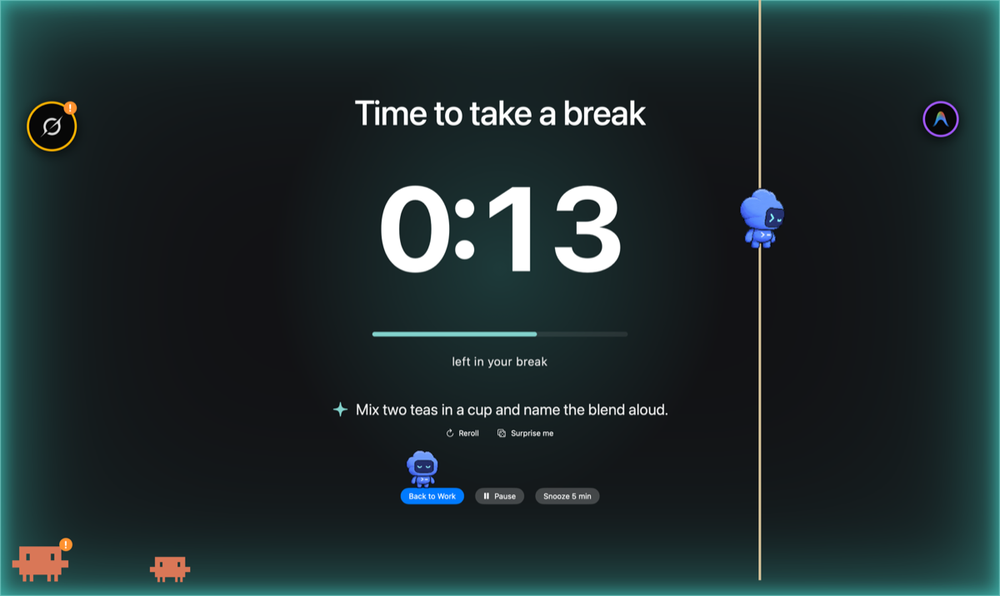

  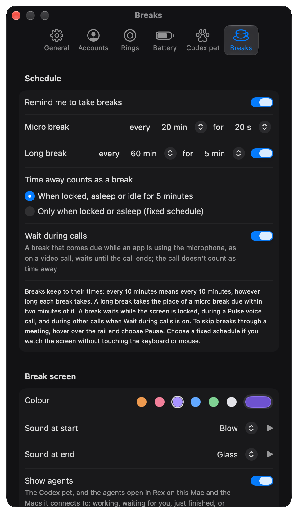
  &nbsp;
  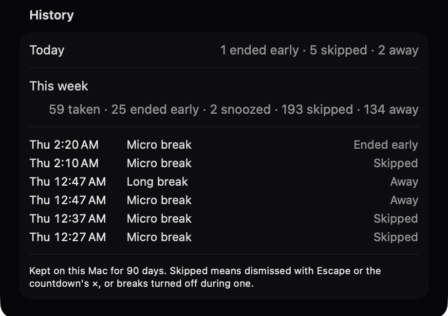

To try it without waiting, turn breaks on and run `defaults write io.github.tommyent.pulse simulatedBreak micro` (or `long`): each run is one countdown, and a simulated break leaves the schedule alone. `defaults write io.github.tommyent.pulse simulatedAgents "claude-code working, codex blocked"` shows stand-in agents instead of Rex's, and `defaults write io.github.tommyent.pulse simulatedIdea "…"` shows that text as every break's idea; `defaults delete io.github.tommyent.pulse simulatedAgents` (or `simulatedIdea`) undoes either. Pulse logs what breaks do, from each countdown to how it ended and what counted as time away: `log stream --predicate 'subsystem == "io.github.tommyent.pulse" AND category == "breaks"'`.

## Codex pet

Chat by text or live voice, with conversations and permission controls. [See the Codex pet guide](codex-pet.md).
